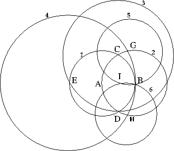

本文介绍如何只使用圆规作出给定两点的中点.

作法:\
假设两点为A, B. 现作出它的中点I.

1\. 以 A 为圆心, 半径 ＝ AB 作 圆1, 令 AB ＝ R.\
2\. 以 B 为圆心, 半径 ＝ R 作 圆2, 交 圆1 于 C, D 两点, 令 CD ＝ R’.\
3\. 以 C 为圆心, 半径 ＝ R’ 作 圆3, 交 圆1 于 E 点, 则 BE ＝ 2R 为 圆1 的直径.\
4\. 以 E 为圆心, 半径 ＝ 2R 作 圆4, 交 圆2 于 G, H 两点, 则 BG ＝ BH ＝ R.\
5\. 以 G 为圆心, 半径 ＝ R 作 圆5.\
6\. 以 H 为圆心, 半径 ＝ R 作 圆6, 交 圆5 于 I 点, 则 I 即 为 A, B 中 点.

