We went hiking MacLehose Trail Stage 5 (10.6 km in total) on Nov. 13, and climbed to the Lion Rock along MacLehose Trail. It took us about 6 hours including around 1 hour to climb the Lion Rock and lots time for sight view.

My suggested route from our experience:

1.  Take a taxi to Gilwell Camp Site (基維爾營地) from the Choi Hung (彩虹) MTR Station (or HKUST if you starts there as us).
2.  Go through the Camp Site’s gate (pass the CampSite Office, a very small gate) to the MacLehose Trail.
3.  Start from the Tate’s Cairn (大老山; Tai Lo Shan).
4.  Reaches the west end of MacLehose Trail Section 5: Tai Po Road (大埔公路).
5.  Take bus 81 at Shek Lei Pui Reservoir (石梨貝水塘) station to Price Edward or Mong Kok MTR station.

More about MacLehose Trail Stage 5:

Photos taken:

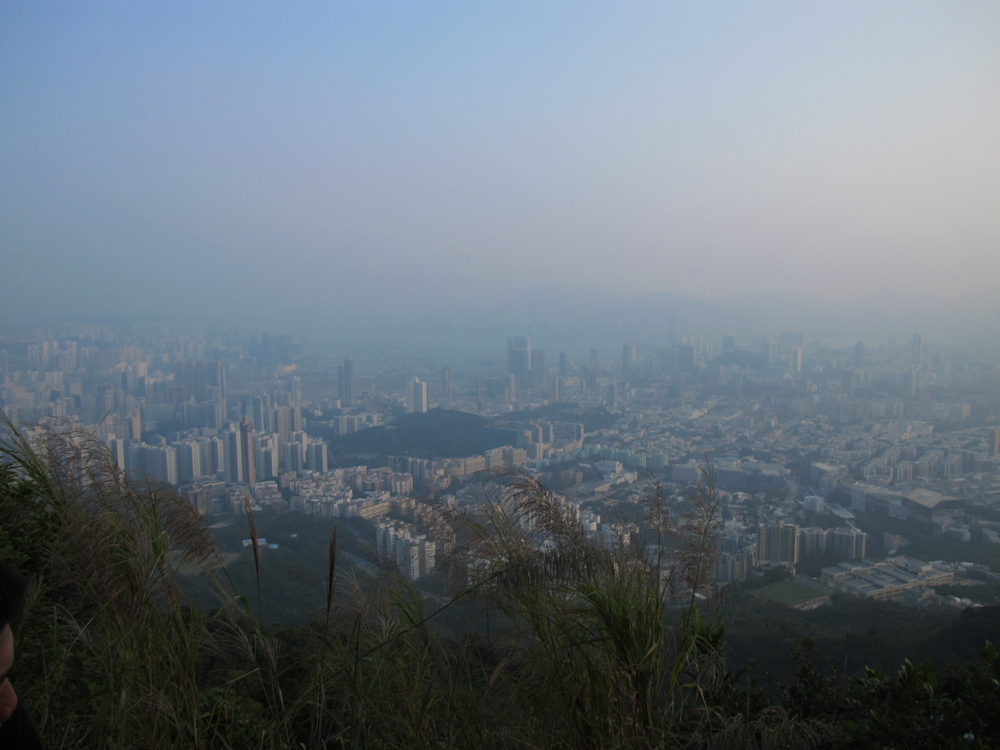

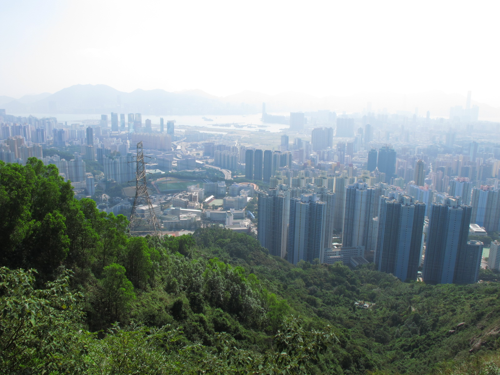

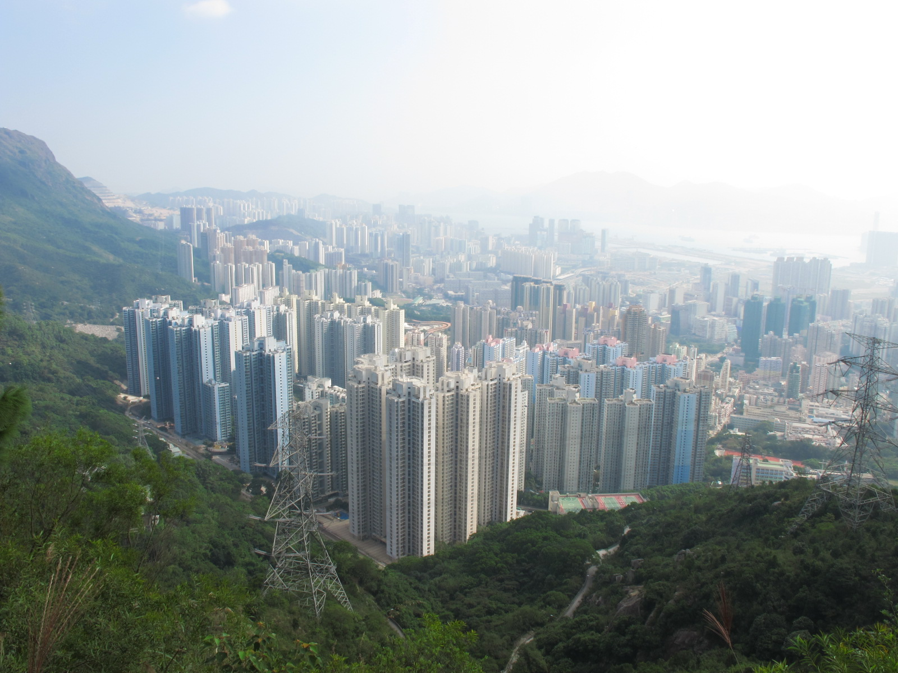

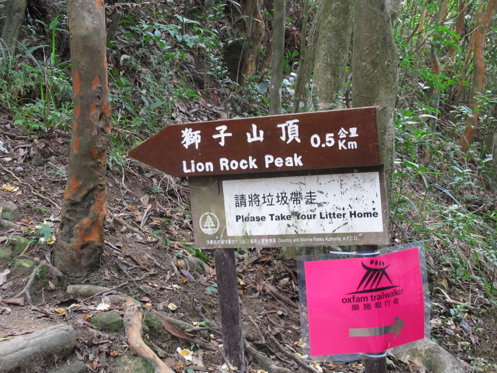

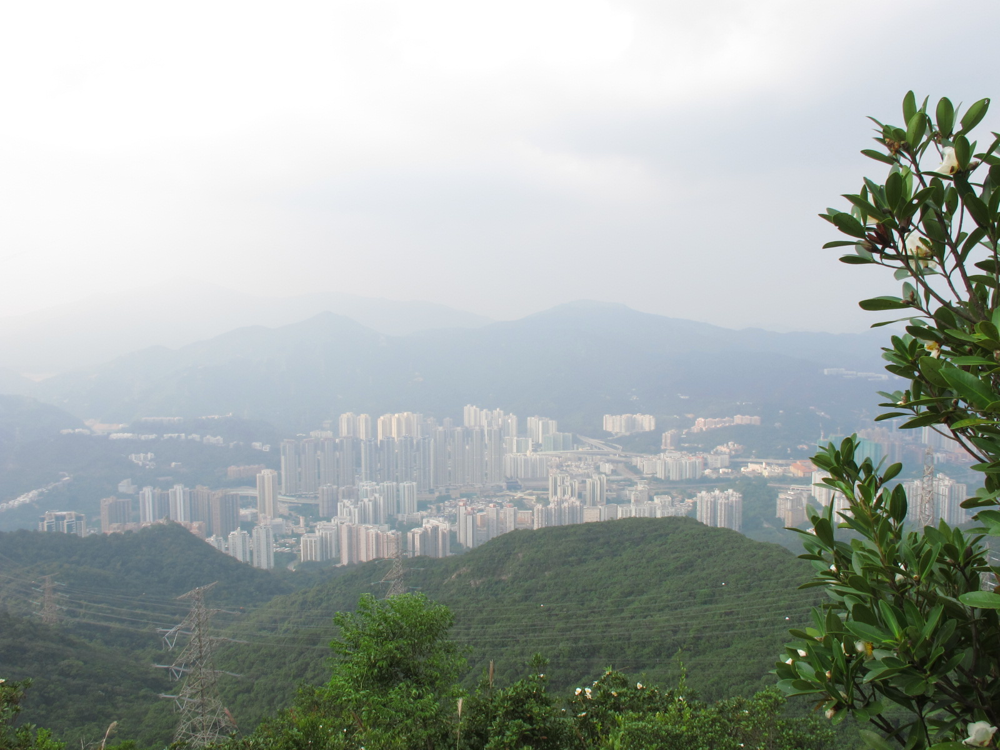

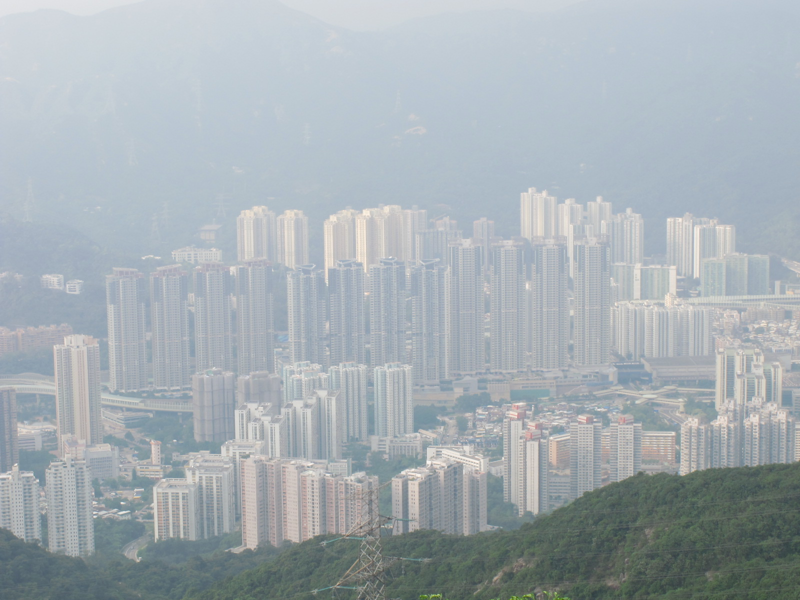

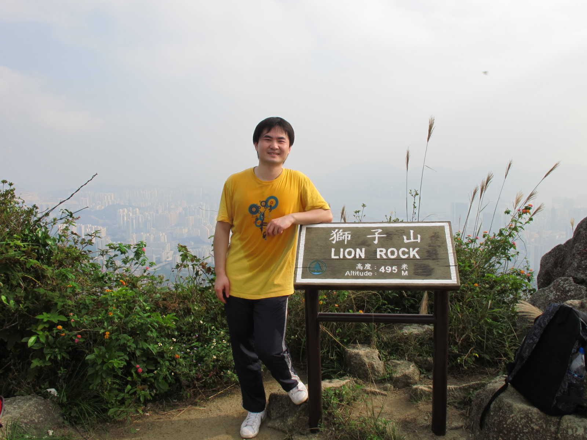

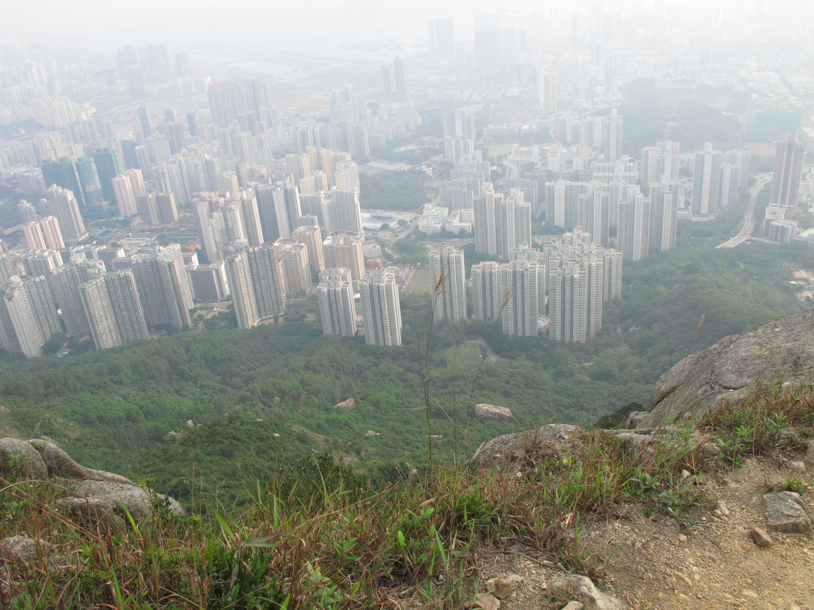

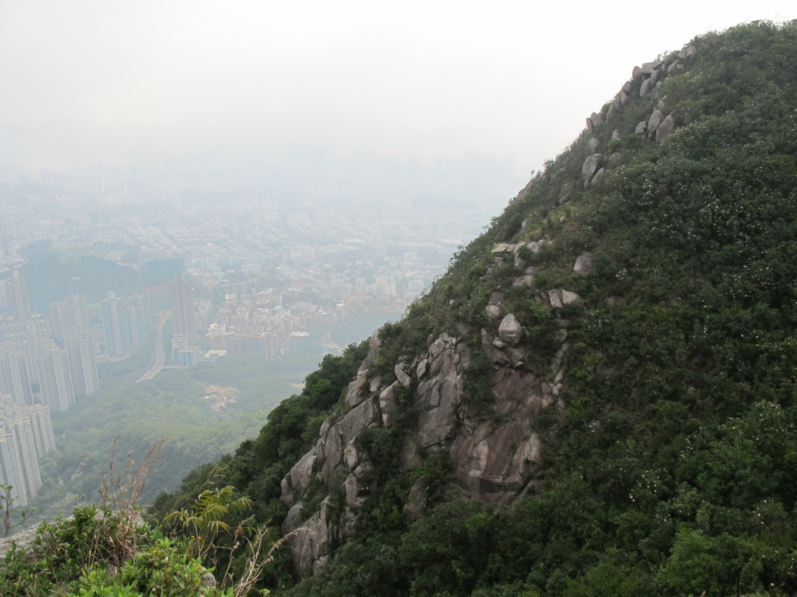

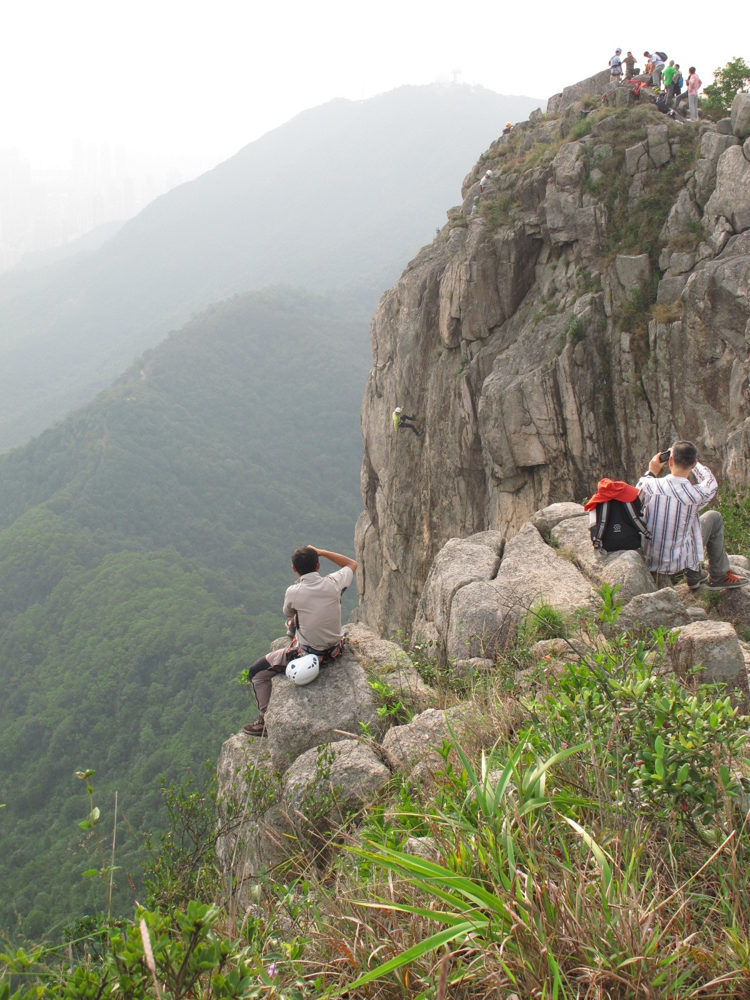

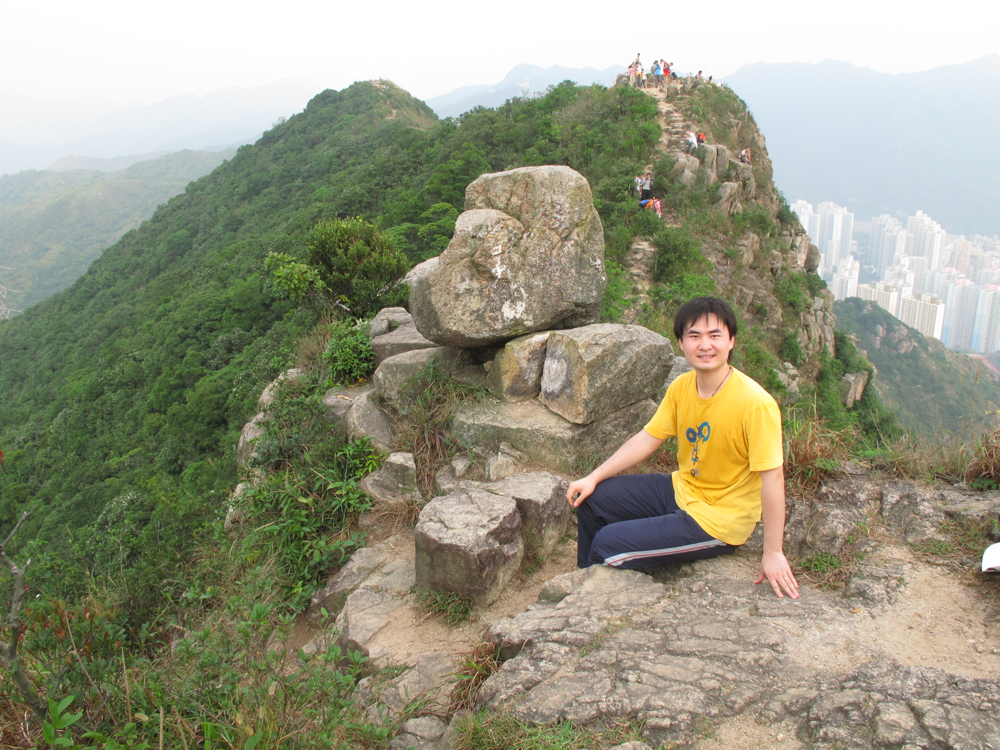

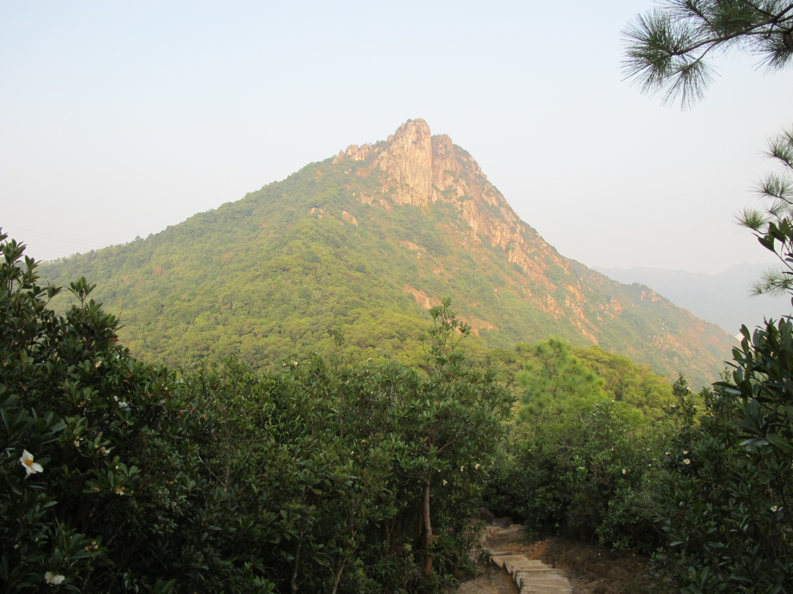

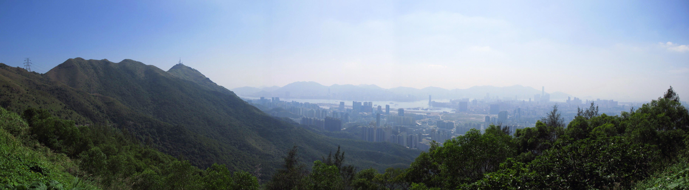

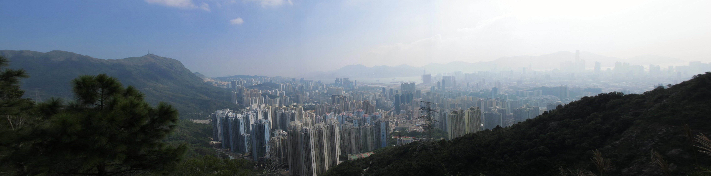

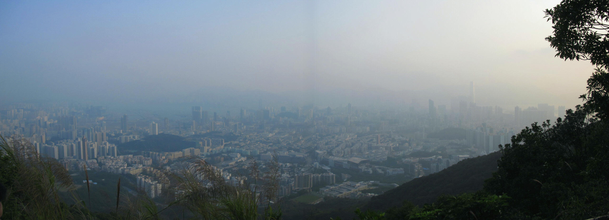
