We hided most sections of the Maclehose Trail in the last several year and have only [Section 9 of Maclehose Trail](http://hkwalkers.net/eng/longtrail/mtrail/mtrail/mtrail09.htm) left. This section is relatively short and there is no bus out from Tin Fu Tsai:

> Maclehose Trail Section 9\
> Starting Point: Route Twisk\
> Finishing Point: Tin Fu Tsai\
> Length: 6.3 kilometres\
> Time: 2.5 hours\
> Difficulty: Easy Walk

So we take Maclehose Section 9 with another one: walk along the [Yuen Tsuen Ancient Trail (元荃古道)](http://www.lcsd.gov.hk/healthy/hiking/en/road_nature6.php) to [Sham Tseng Village (深井)](http://en.wikipedia.org/wiki/Sham_Tseng) and take bus out from there.

The is the plan I made while it turned that it took us less time since the trail is easy and mainly down the mountain.

- 10:30 Reach the Tsuen Wan MTR station.
- 10:30-11:45 Take Bus 51 (note: the station is on the "roof" of the MTR station) from the Tsuen Wan MTR station and get off at the "Country Park" station to reach Tsuen Kam Au (荃錦坳).
- 11:45-14:45 Start Maclehose Trail Section 9. Reach "Tin Fu Tsai".
- 14:45-17:15 After passing the "Tin Fu Tsai", walk for a while and turn left at a crossroad where there is a emergency telephone nearby. Walk to the "Tsing Fai Tong Village (清快塘)" along the Yuen Tsuen Ancient Trail. Walk along the foot path and reach the Sham Tseng Village.
- 17:15 Take bus to Tsuen Wan MTR station.

The maps: [Maclehose Trail Section 9](http://hkwalkers.net/eng/pdf/longtrail/mtrail/m09map.pdf), [Yuen Tsuen Ancient Trail](http://www.lcsd.gov.hk/healthy/hiking/graphics/map_large/A6_map.jpg).

It is overall an easy one and should be good for family hiking. Those who want to make it not that easy may consider hiking backwards from Sham Tseng to Tsuen Kam Au.

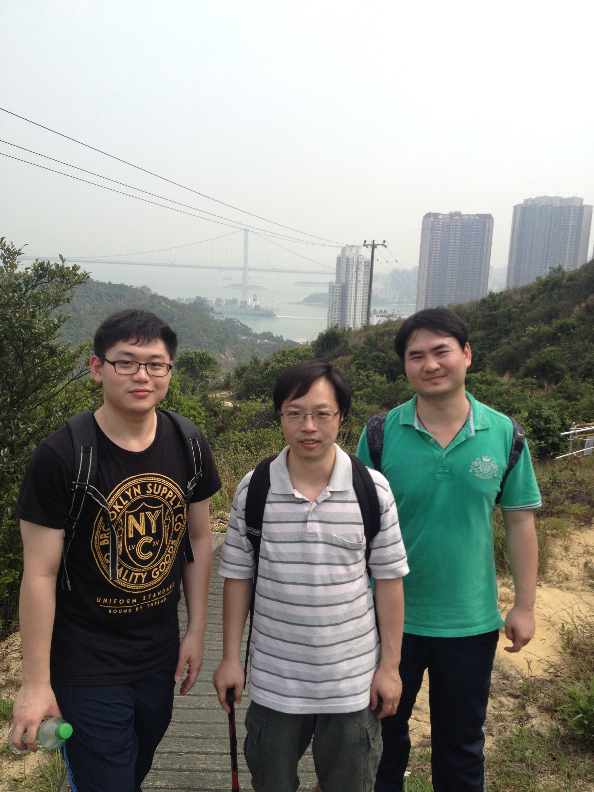\
The members. It may be the last time the \[Ke\](http://www.hongkedavid.com) hikes with us before he goes to US for his PhD study.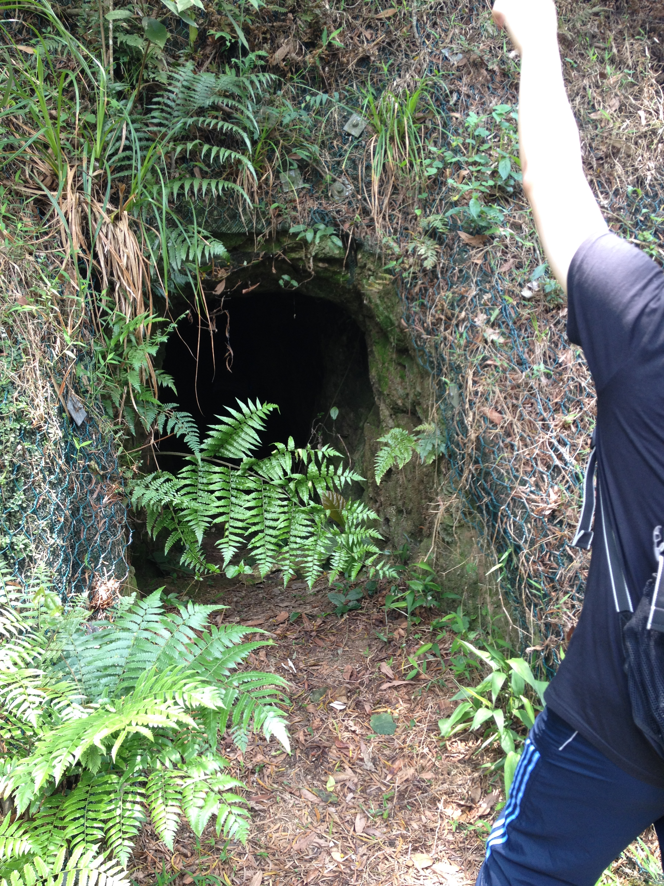\
A cave along Maclehose Trail Section 9. Did not figure out what is the usage.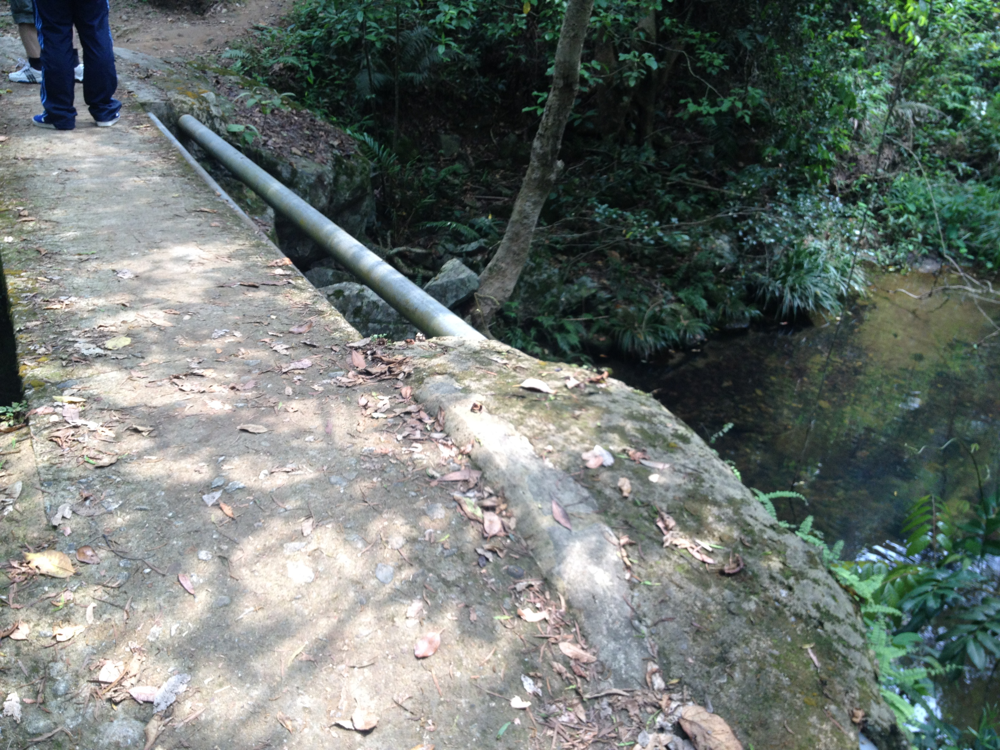\
Starting the Yuen Tsuen Ancient Trail. The little bridge and the little stream.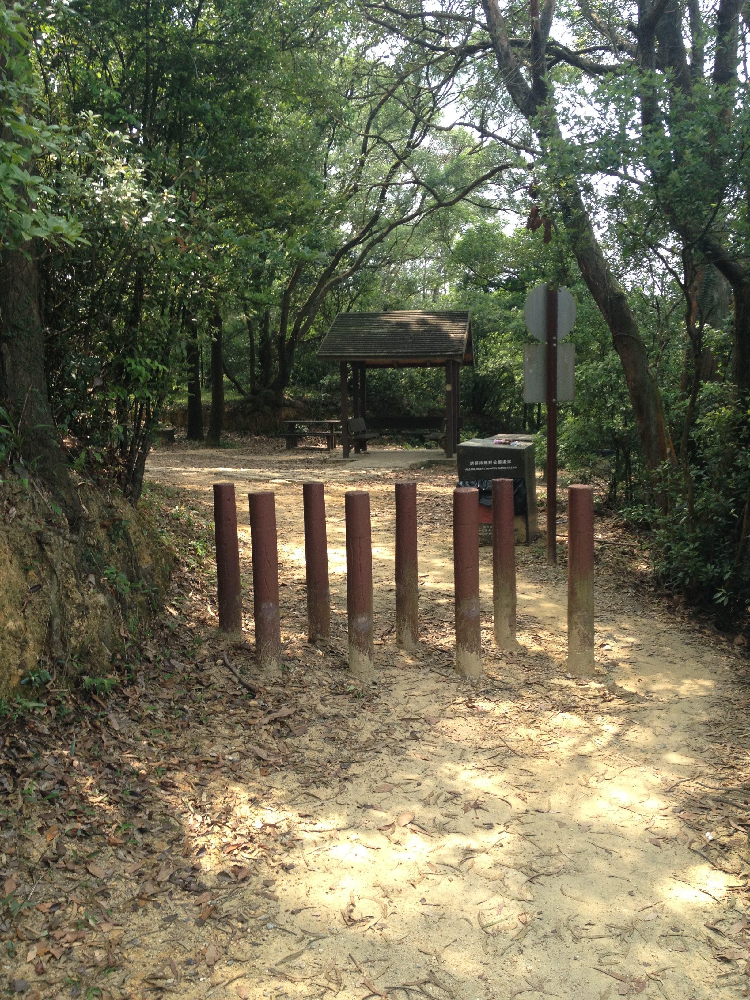\
A pavilion. Yuen Tsuen Ancient Trail.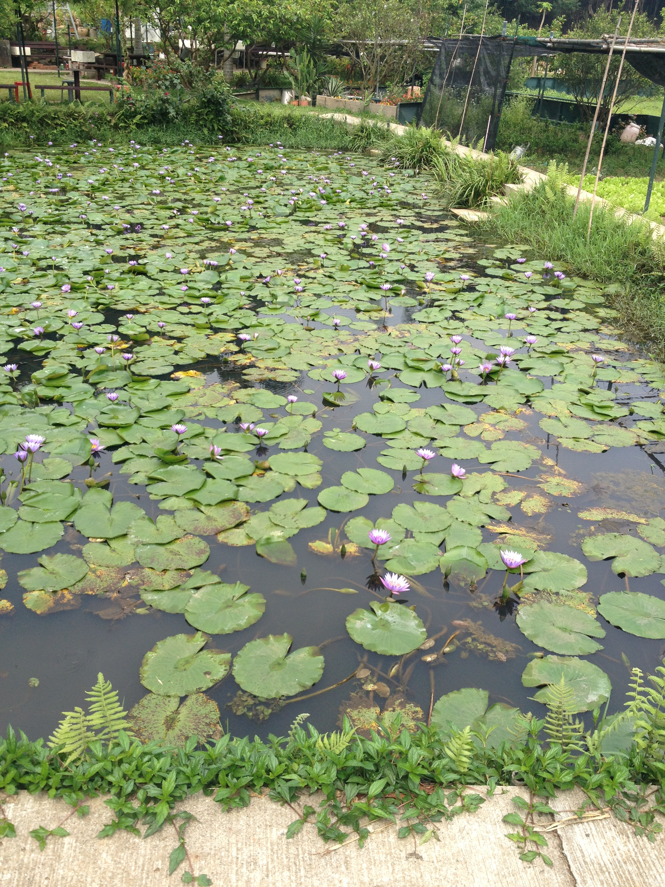\
Lotus pool in the Tsing Fai Tong Village.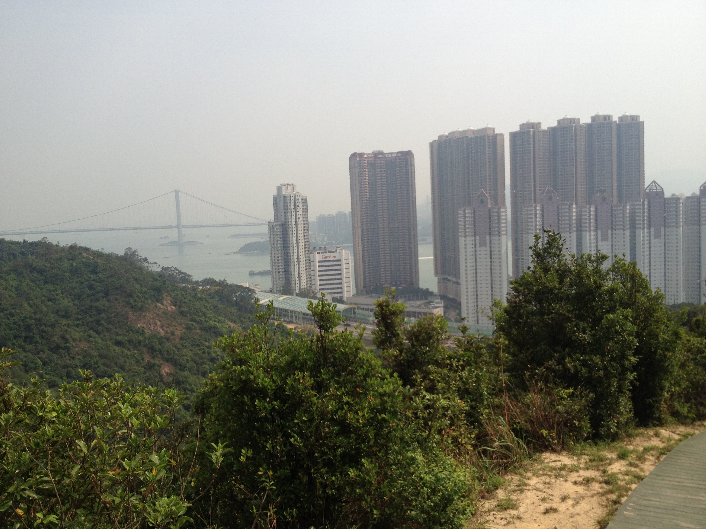\
View of Sham Tseng Village from the mountain.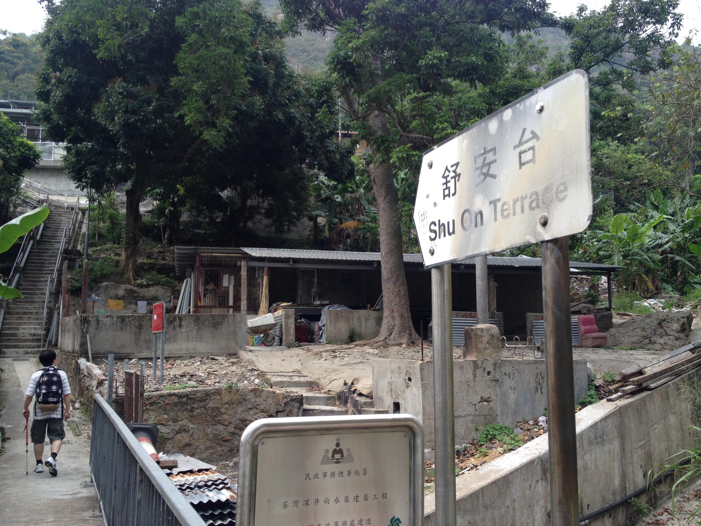\
Reach Shu On Terrace (舒安台).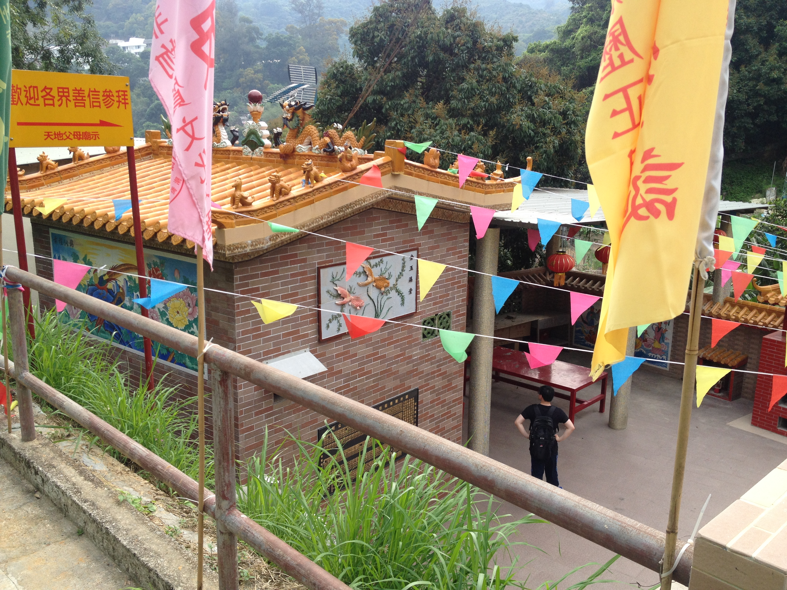\
The temple in Shu On Terrace.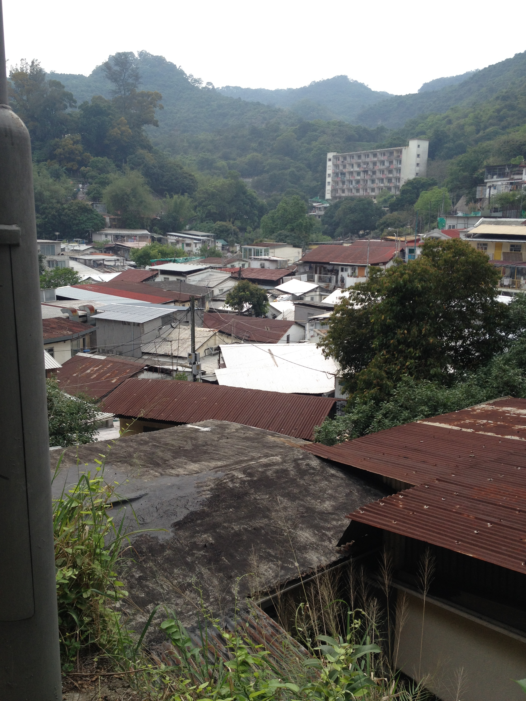\
The Sham Tseng village.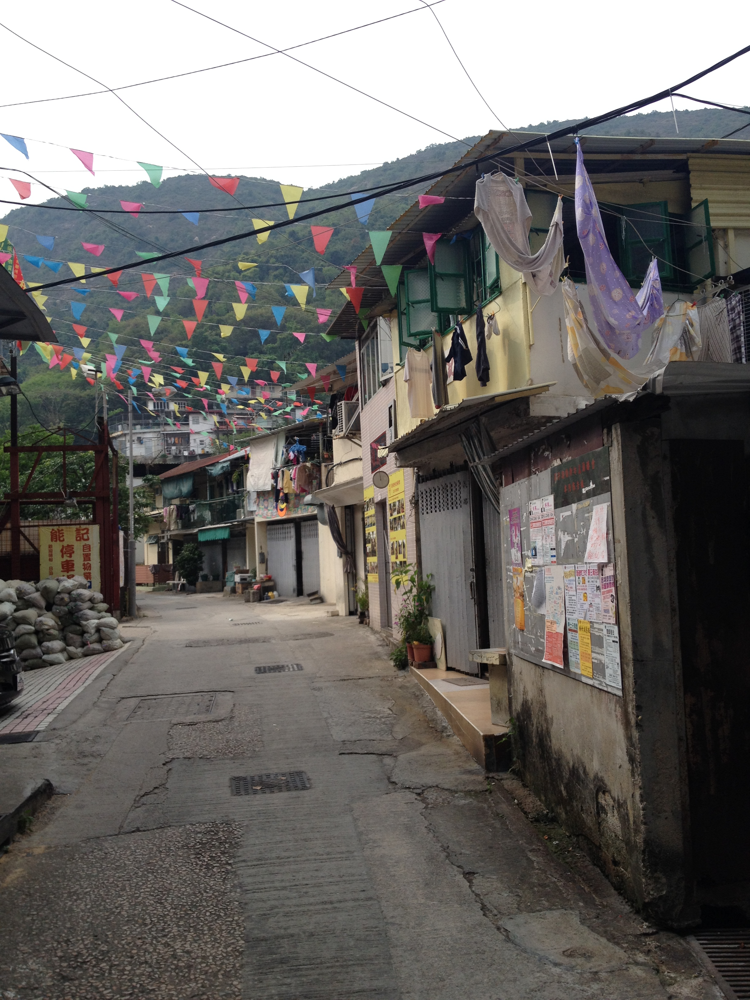\
The Sham Tseng village.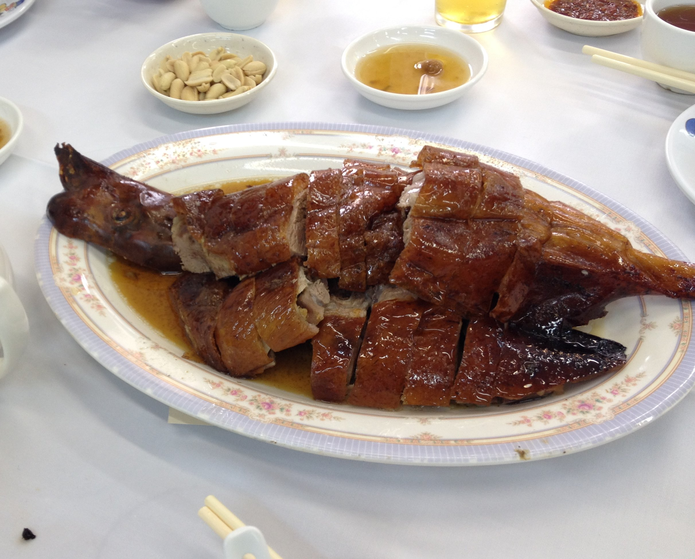\
Thanks to Prof. Gu for buying us the dinner. The Sham Tseng roasted goose is good.

Enjoy.
