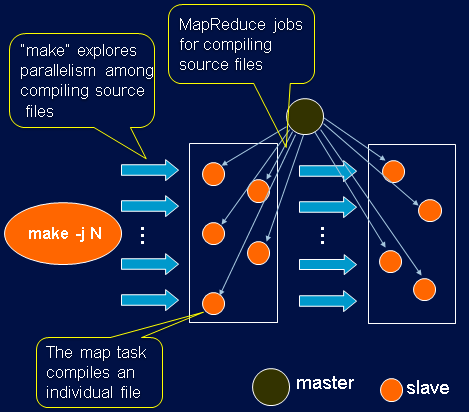

This page lists some of Eric Zhiqiang Ma's public projects.

## Software releases

### [mrcc](https://github.com/zma/mrcc) — a distributed C compiler system on MapReduce

mrcc is an open source compilation system that uses MapReduce (such as Hadoop
and MRlite) to distribute C code compilation across the servers in the cloud
computing platform. mrcc is originally built to use Hadoop, but it is easy to
transform it to other cloud computing platforms by only changing the interface
to the computing platform.

mrcc consists of one master node that controls the compilation job and many
slave nodes that handle the compilation tasks.

An introduction to the architecture and implementation of mrcc can be found in
the [mrcc document](https://www.systutorials.com/699/mrcc-a-distributed-c-compiler-system-on-mapreduce/)
and the paper *The Limitation of MapReduce: A Probing Case and a Lightweight
Solution*.

Related papers:

- Z. Ma and L. Gu. *The Limitation of MapReduce: A Probing Case and a
  Lightweight Solution*. In Proc. of the 1st Intl. Conf. on Cloud Computing,
  GRIDs, and Virtualization (CLOUD COMPUTING 2010). Nov. 21-26, 2010, Lisbon,
  Portugal. ([PDF](/assets/files/ma2010mrlite.pdf))
- Z. Ma. *Large-Scale In-Memory Data Processing*. PhD Thesis Defence.
  Aug. 12, 2014, HKUST.
  ([PDF from HKUST library](http://lbezone.ust.hk/bib/b1333669))

mrcc is licensed under GPLv2.

### [zlog](https://github.com/zma/zlog) — a low-latency in-memory C logging library

zlog is a C in-memory logging library. It allocates a buffer in memory for
efficient logging. The library flushes the buffer to the log file (or stdout)
when the buffer is full.

The program can also explicitly flush the log, or create a flushing thread
(provided by the library) to flush the buffer every period of time. zlog
provides printf-like interfaces for formatting the log and zlog is thread
safe, which makes it a convenient logging tool for C programs.

The main reason for in-memory logging is **very low latency**: for some
critical software components, timing is sensitive and the cost of touching
the I/O is not acceptable. In-memory logging is a good fit for this kind of
software.

zlog is released to the [public domain](http://unlicense.org).

### Other contributions

- [cc0](https://sourceforge.net/p/cc0/code/ci/master/tree/) (contributor) —
  a c0 compiler. c0 is a variation of the C programming language with some
  extensions to support language-level multi-tasking.
- [libi0](https://github.com/layerzero/libi0) (core developer) — a general
  library for writing C0 code targeted i0. i0 is the ISA for Layer Zero which
  unifies myriads of nodes in the datacenters to form a big virtual machine.

## Articles, tutorials and howtos

- [SysTutorials](https://www.systutorials.com/author/zma/): Tutorials, howtos
  and tips on Linux, software and more.
